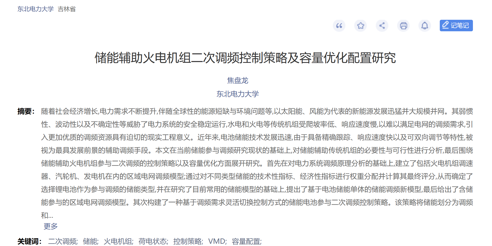

# Research on Secondary Frequency Control and Capacity Optimization Configuration of Energy Storage Supported Thermal Power Units (Matlab Code and Simulink Simulation)

Research on the Secondary Frequency Modulation Control Strategy and Capacity Optimization Configuration for Energy Storage-Aided Thermal Power Units (Matlab Code and Simulink Simulation)
References:
[1] Jiao Panlong. Research on the Secondary Frequency Modulation Control Strategy and Capacity Optimization Configuration for Energy Storage-Aided Thermal Power Units [D]. Northeast Electric Power University, 2020. DOI: 10.27008/d.cnki.gdbdc.2020.000096.

## Images

<!-- PAYMENT_BLOCK -->

## Get this dataset

- Payment link (Stripe): [Buy now](https://buy.stripe.com/3cs8yP7sY87d0vu9AB)
- Payment QR code: 

<!-- /PAYMENT_BLOCK -->
